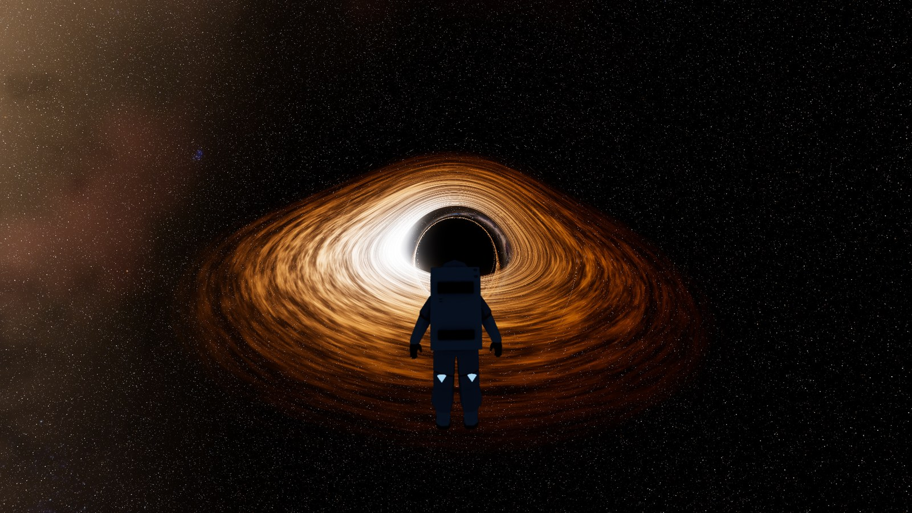
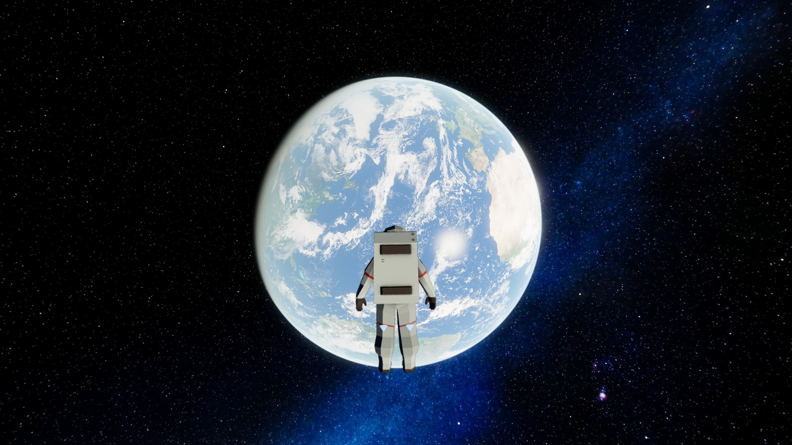
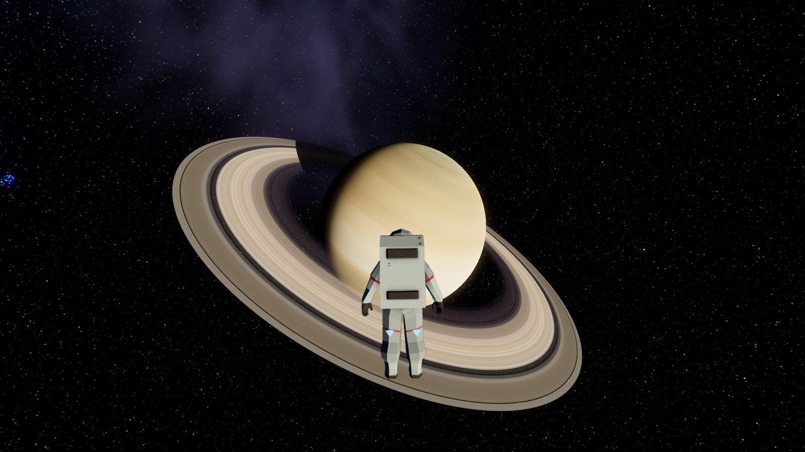
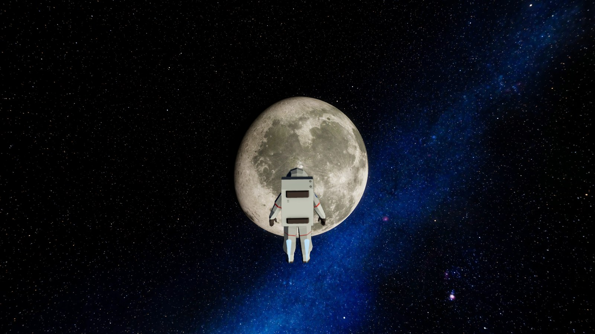
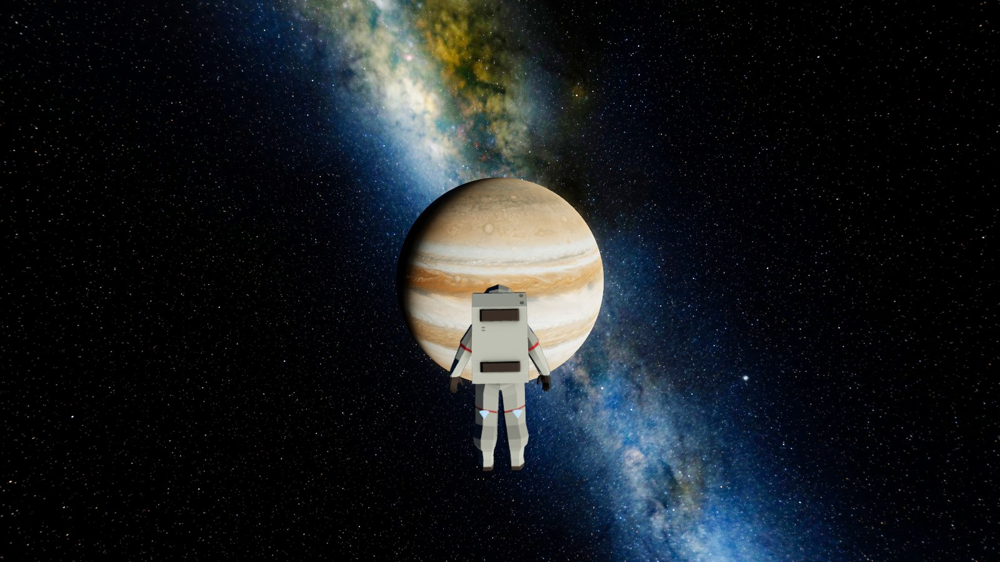
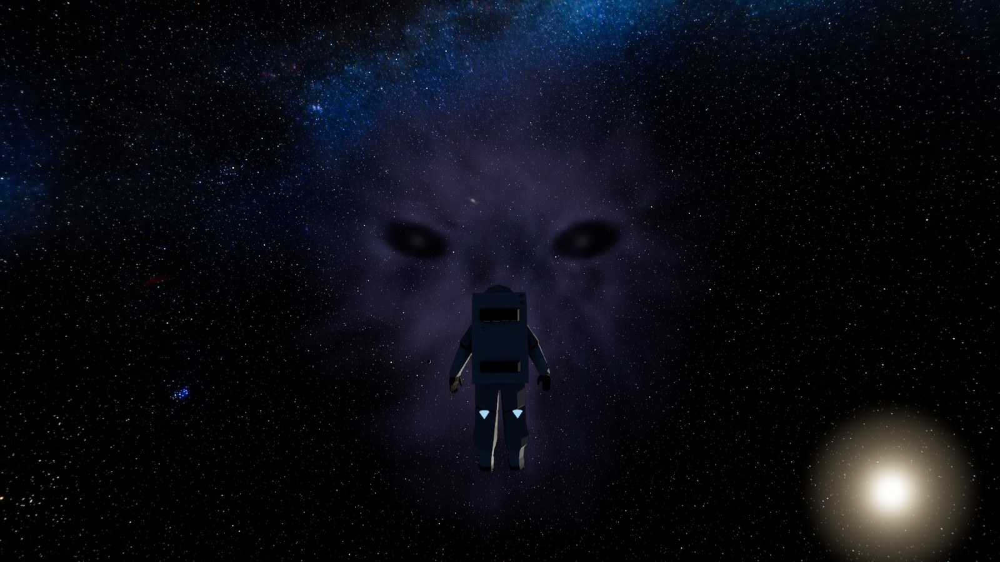
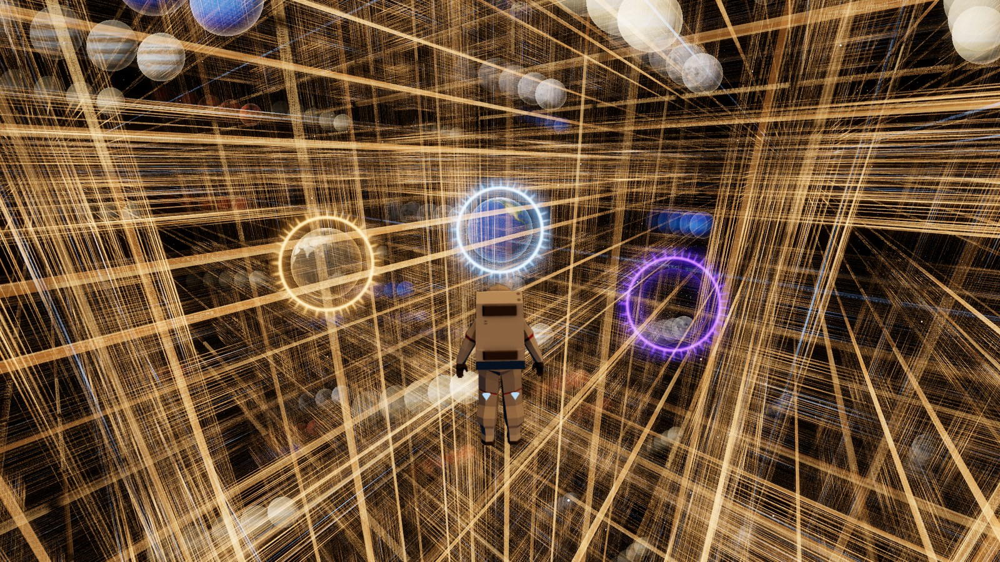
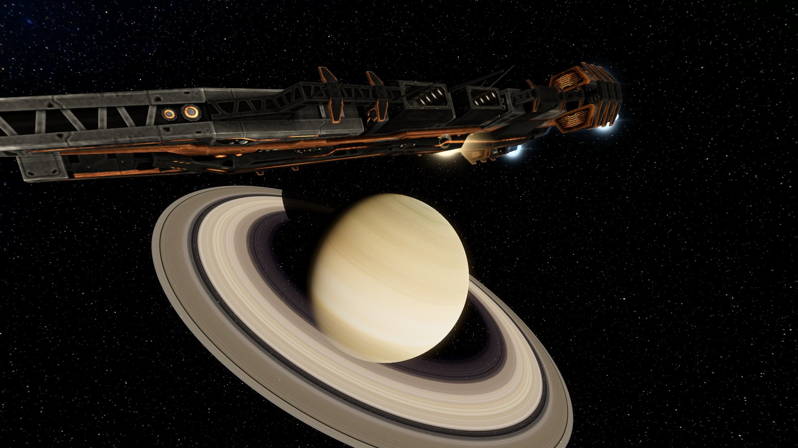

# Uzay

**A true-scale space game I made for my daughter.** *Uzay* means "space" in Turkish.

You are an astronaut with a jetpack. The Sun, every planet and the stars around us are where they
really are and as big as they really are, so you feel as small as you would out there. Fly from
Earth orbit down to the Moon and walk on it, cross to Saturn, travel to other stars, and fall into
the black hole at the centre of our galaxy.

| | |
| --- | --- |
|  |  |
|  |  |

## What is in it

- **The real Solar System at 1:1 scale.** Real sizes, real distances, real orbits. Nothing is
  enlarged to look good.
- **A real night sky.** About 15,000 stars from the HYG catalogue in their true places and
  colours, over a photograph of the Milky Way.
- **No loading screens.** Fly from deep space through the air to the ground and walk away, in one go.
  Dive too fast and the air burns around you.
- **Other stars to visit:** Alpha Centauri, Sirius, Vega, TRAPPIST-1, Betelgeuse and more.
- **A black hole that bends light.** Sagittarius A* is ray-traced with real gravitational lensing.
  Cross the event horizon and there is no way back.
- **A story.** Something is coming, and nobody knows how to stop it. The game never tells you what
  to do about it.
- **Plays fully on a controller** or on keyboard and mouse.

<b>Story spoilers</b> (the game itself never says any of this)

A cloud wider than the Solar System, with a face in it, is drifting in. It does not notice you.
It opens its mouth only when a world is about to go, and worlds simply stop being there, outermost
first (Earth after 27 minutes of play). Earth Dispatch and your own thoughts tell you how close it
is, and you can see it from every world, even through a daylight sky.

The only way to stop it is inside the black hole. You fall for about a minute, then the tesseract
opens and, after a while, three windows appear in it. Look at one to read it, then fly into it or
press Enter / Start / X to reach through. Only one of them saves the world.

## Play

- **Download:** get the zip for Windows, macOS or Linux from the
  [latest release](https://github.com/mert-atalay/uzay/releases/latest), unzip and run it. On macOS
  the first launch needs right-click → Open, since the build is not notarized.
- **From source:** install [Godot 4.7.2](https://godotengine.org), open this folder in the editor
  (Import → `project.godot`) and press F5.

It needs a graphics card that supports Vulkan.

## Controls

| Action | Keyboard / mouse | Gamepad |
| --- | --- | --- |
| Move | W A S D | Left stick |
| Up / down | Space / Ctrl | A / B (or left trigger for down) |
| Look | Mouse | Right stick |
| Roll | Q / E | LB / RB |
| Boost | Shift | Right trigger |
| Throttle up / down | Scroll, or ] / [ | D-pad up / down |
| Time speed | T | Back |
| Travel menu (warp to any planet, star or the black hole) | Tab | Start |
| Warp to the black hole / back to Earth | B / N | D-pad right / left |
| Warp to what you are looking at | J | X |
| Music on / off | M | |
| Third / first person | V | Right stick click |
| Toggle markers | H | Y |
| Free the mouse | Esc | |
| Fullscreen / window | F11 | |
| Screenshot (saved in a `screenshots` folder next to the game) | F12 | Left stick click |

The game starts fullscreen. In the travel menu, move with the D-pad or arrows, A / Enter picks a
destination, B / Esc closes. The bottom-left hint line names the controller the game has found.

**Flying:** your top speed depends on how far you are from the nearest surface: slow near a
planet, faster than light in empty space.

**Landing:** fly down to any rocky planet or moon. Touch the ground and you are on foot: W A S D
walk, Shift runs, Space jumps (try the Moon). Hold Space to fire the jetpack and fly again.

## How it was made

It began as a small prototype in Google AI Studio (kept in `prototype-web/` for reference). I
then rebuilt it from scratch in [Godot 4](https://godotengine.org) and GDScript, working with
[Claude Code](https://claude.com/claude-code). A few things that make true scale work:

- Positions are 64-bit metres. The player stays at the origin and the universe moves around them.
- Far objects are pulled in and shrunk about the camera so their size in the sky is unchanged,
  which lets one camera draw a 2 m astronaut and a star 600 light-years away.
- The black hole and the Devourer are drawn per pixel by marching rays through curved space and
  through mist.
- The simulation (orbits, flight, terrain, story timing) is plain code with headless tests:
  `godot --headless -s res://tests/run_tests.gd`. Every push is built for Windows, macOS and Linux.

`CLAUDE.md` has the full map of the code.

## Credits

- Planet textures: [Solar System Scope](https://www.solarsystemscope.com/textures/) (CC BY 4.0).
- Milky Way panorama: [Stellarium](https://github.com/Stellarium/stellarium) (GPL).
- Star catalogue: [HYG database](https://github.com/astronexus/HYG-Database) (CC BY-SA 4.0).
- Astronaut: Poly by Google (CC BY).
- Rescue ship: "Osiris Mothership" by alx_flameniro on Sketchfab (CC BY 4.0).
- Music and the black hole drone are original, synthesised by `tools/make_theme.py` and
  `tools/make_drone.py`.
- Engine: [Godot](https://godotengine.org) (MIT).
